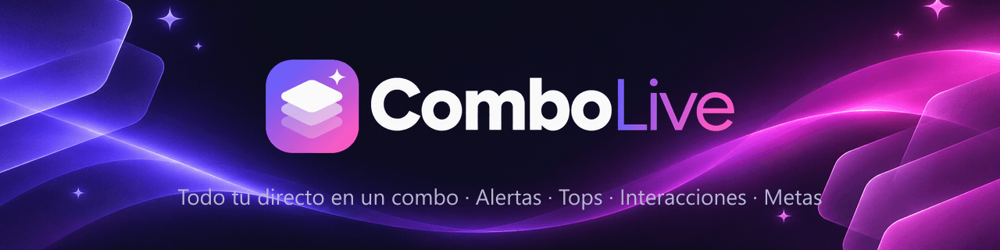
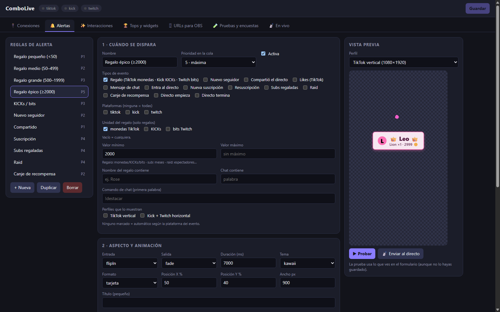

  

  Alertas · Tops · Interacciones · Metas para <b>TikTok LIVE</b>, <b>Kick</b> y <b>Twitch</b>. 
  Una sola app para Windows, con panel visual y sin escribir código.

  

  
  
  

  

---

## ✨ Qué hace

| | |
|---|---|
| 🔔 **Alertas** | Regalos, seguidores, suscripciones, raids y canjes. 12 animaciones, 6 temas, sonido, vídeo y vista previa en vivo antes de salir al aire. |
| 🏆 **Tops y metas** | Rankings por sesión, día, semana, mes o total (lista o podio), barras o anillos de meta y contadores. |
| ✨ **Interacciones** | Confeti, fuegos artificiales, corazones flotando, contador de combo de regalos, banners por comandos del chat y encuestas (1/2/3). |
| 🖥 **Para OBS** | Cada overlay es una dirección local que añades como *Navegador* en OBS. Formatos vertical (TikTok, 1080×1920) y horizontal (Kick y Twitch, 1920×1080). |
| 🔄 **Se actualiza sola** | La app avisa cuando hay una versión nueva y te pregunta antes de instalarla. |
| 🔒 **Privada por diseño** | Todo corre en tu PC. Sin cuenta, sin nube: tu configuración, rankings y claves se quedan en tu equipo. |

## ⬇️ Instalar

1. **[Descarga el instalador](https://FARS1803.github.io/combolive/)** (o desde [Releases](https://github.com/FARS1803/combolive/releases/latest)).
2. Ábrelo. **No pide permisos de administrador.**
3. Si Windows muestra **“Windows protegió su PC”**: *Más información → Ejecutar de todas formas*. Ocurre porque el instalador aún no tiene firma de código de pago; no significa que esté dañado. Puedes comprobar su huella con `Get-FileHash`.
4. Abre **ComboLive** → *Conexiones* → conecta TikTok, Kick y/o Twitch → copia cada URL en *URLs para OBS*.

**Requisitos:** Windows 10 u 11 (64 bits). Por ahora solo Windows.

## ⚠️ Transparencia

- La conexión con **TikTok** y la lectura del **chat de Kick** usan métodos **no oficiales** (TikTok no ofrece API pública para esto). Pueden dejar de funcionar sin aviso si esas plataformas cambian.
- **Twitch** usa su API oficial.
- Este repositorio contiene solo la página de descargas y los instaladores. El código fuente de la aplicación es privado.

## ❓ Preguntas frecuentes

<b>¿Funciona en Mac o Linux?</b>

Por ahora no: solo Windows 10/11 (64 bits).

<b>¿Necesito una cuenta?</b>

No. Solo conectas tus plataformas dentro de la app; los datos se guardan en tu PC.

<b>¿Cómo se actualiza?</b>

La app busca versiones nuevas en este repositorio. Si hay una, te avisa, te deja descargarla y te pregunta antes de reiniciar para instalarla. Tus datos se conservan.

<b>¿Dónde se guardan mis datos?</b>

En <code>%APPDATA%\ComboLive</code>. No se borran al actualizar ni al desinstalar.

---

Software de uso personal · todos los derechos reservados

